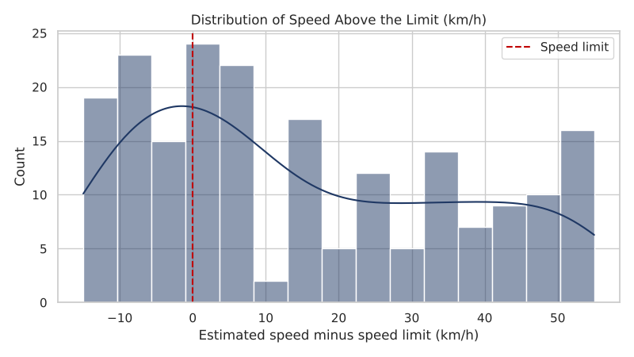
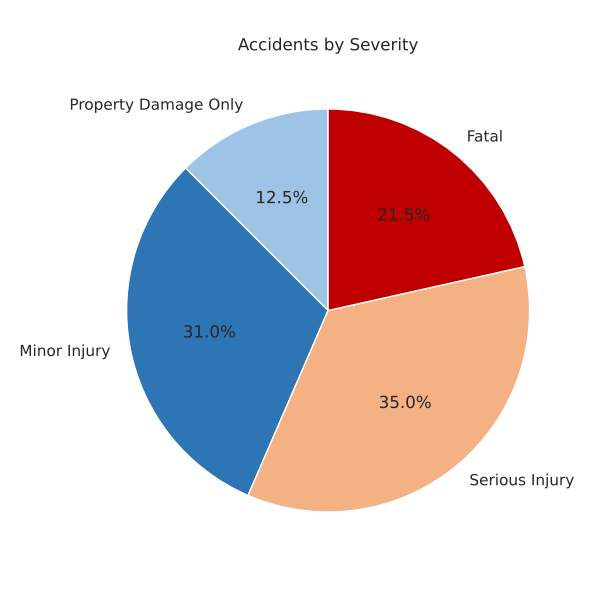
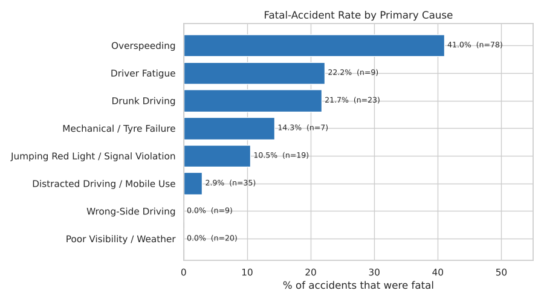
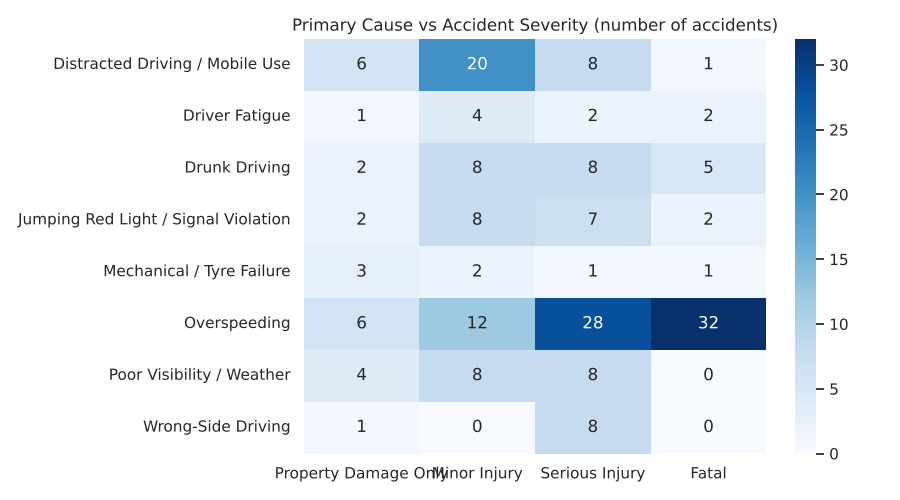

# Road Accident Analysis (Data Analyst Project)

A simple data analysis project. It looks at **one factor – Primary Cause** – to find which cause of road accidents is the most dangerous. Tools: Python, pandas, NumPy, matplotlib, seaborn, Jupyter Notebook.

> The dataset is **synthetic** (practice data). It is not official road-safety data.

## Business problem
The traffic-safety department wants to know which primary cause leads to the most fatal accidents so it can focus enforcement and awareness campaigns.

## Questions answered
1. How fast were drivers going compared with the speed limit? (histogram)
2. How serious are the accidents overall? (pie chart)
3. Which cause has the highest fatal-accident rate? (bar chart)
4. How does each cause spread across severity levels? (heatmap)

## Dataset
`data/raw/Road_Accident_Analysis_200_Records.xlsx` – 200 accidents, 20 columns. The sheet has an extra typed **Total** row at the bottom that is removed during cleaning.

## Project structure
```
Road_Accident_Analysis_Project/
├── data/
│   ├── raw/Road_Accident_Analysis_200_Records.xlsx
│   └── processed/road_accident_clean.csv
├── notebooks/road_accident_analysis.ipynb
├── images/          (4 charts saved by the notebook)
├── requirements.txt
├── .gitignore
└── README.md
```

## How to run
```bash
pip install -r requirements.txt
jupyter notebook notebooks/road_accident_analysis.ipynb
```
The notebook also works if you put it and the Excel file together in one folder.

## Steps followed
1 Business problem · 2 Import libraries · 3 Load and inspect · 4 Clean data · 5 Create new columns · 6 EDA (4 charts) · 7 Key insights · 8 Recommendations · 9 Save cleaned data

## Key findings (from this dataset)
- Overspeeding is the most common cause (39% of accidents) and the deadliest: 41% of overspeeding accidents were fatal.
- Drunk driving is next (about 22% fatal); distracted driving is common but rarely fatal (about 3%).
- About two-thirds of drivers were above the speed limit.
- Causes with fewer than 10 accidents are too small for reliable rates.

## Charts




